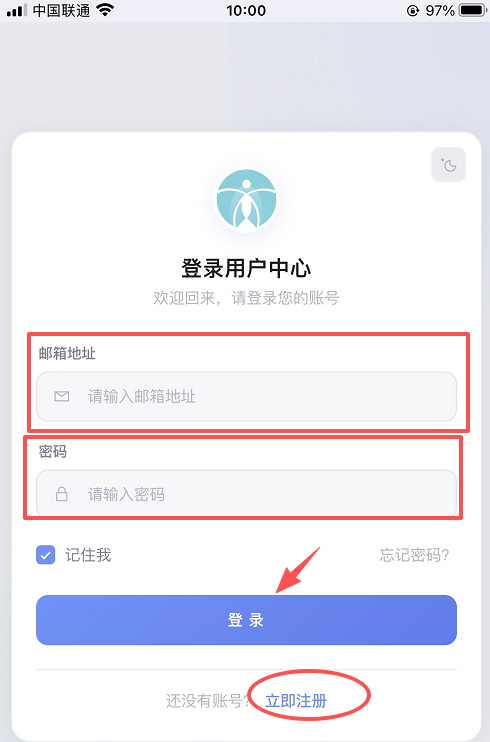
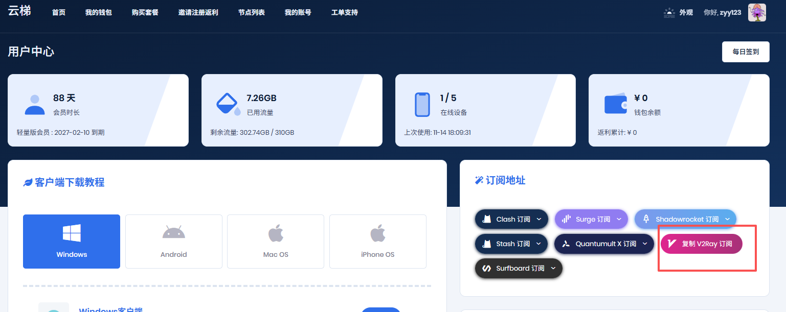
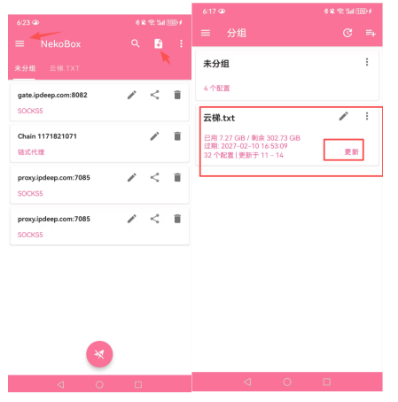
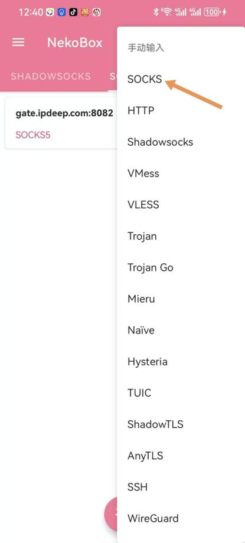
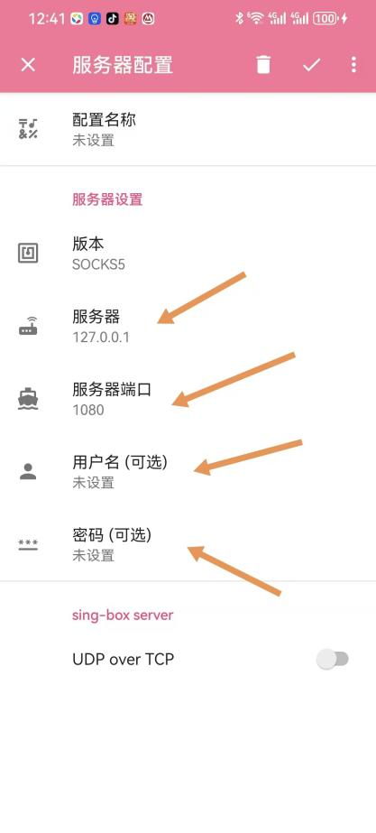
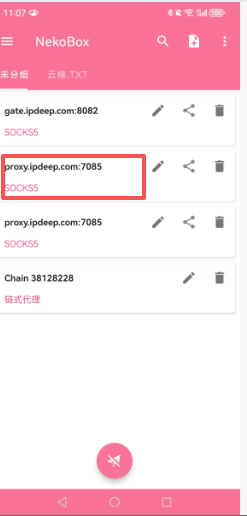
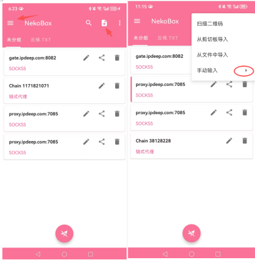
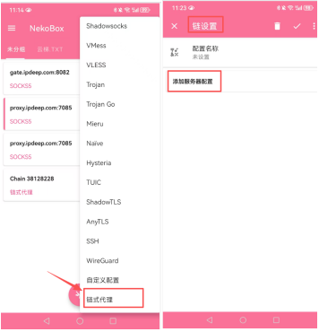
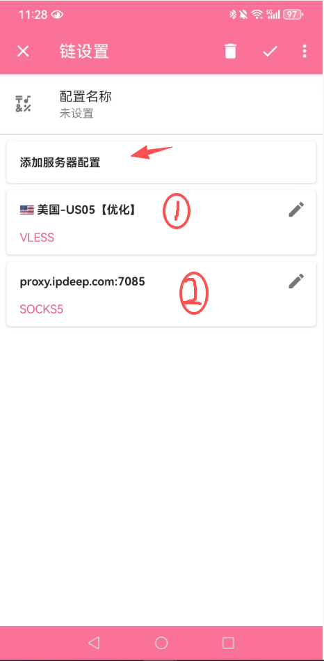
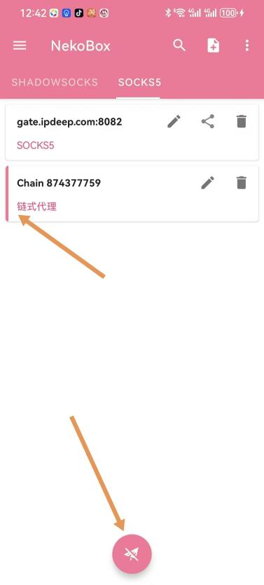

# 安卓手机如何通过两层代理使用Sock5 ip

对于做跨境业务的朋友来说，很多业务场景需要在安卓手机上使用海外Sock5 ip，并且很多Sock5 ip仅支持境外环境使用，那么如何解决呢？【如果想看视频教程，请拉到最底部点击视频链接即可查看】

## 首先下载app“NekoBox”

下载地址：https://nekoboxforandroid.org/nekobox-for-android-download/

### （1）先导入中转代理 shadowsocks节点

如果没有shadowsocks节点，可自行购买，购买参考网站 （以云梯为例）https://my.ytjscloud.com/auth/login ，或者通过谷歌搜索“shadowsocks节点”进行购买

### （2）云梯里面找到订阅地址

复制V2Ray订阅>在NekoBox配置>右上角+号 >从剪切板导入刚刚V2里面复制的链接>是，再分组里面会展示出云梯。

### （3）导入socks5代理ip

输入服务器地址、端口、用户名和密码（选填）或者扫描二维码>保存

### （4）配置

右上角+手动输入点开三角>拉到最下面，找到链式代理>链设置里面添加服务器。

### (5) 添加服务器配置

1.选择云梯节点（选速度最快的），添加服务器配置>2.选择sock5节点，注意顺序，点击“√”，添加成功后如下图

### (6) 选择链式代理

点击连接按钮，即可测试是否连通。

注意事项：1.添加链式代理 2.链式代理添加后勾选节点和IP的顺序

## 🎬 视频教程

地址：https://www.youtube.com/shorts/rXy4rMQtCZU
